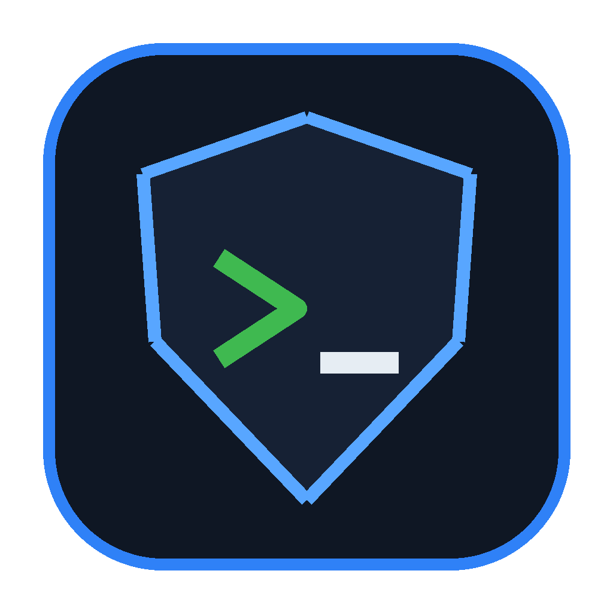
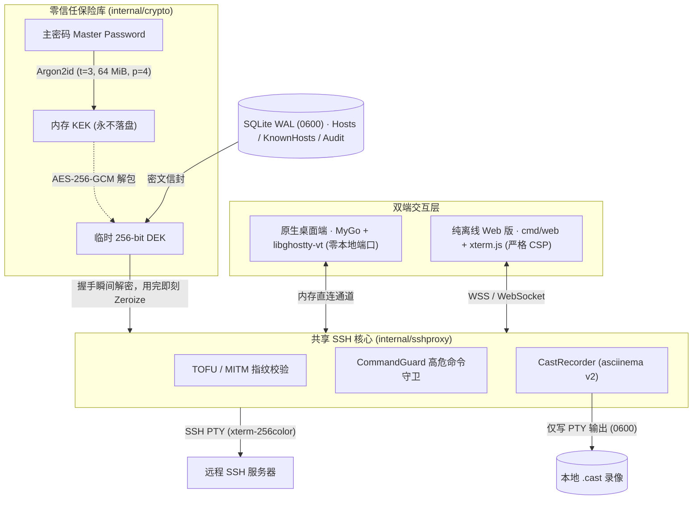

<div align="center">



# SSH-Guard

**基于 Go 构建的轻量级零信任 SSH 安全管理面板**

纯 Go 原生桌面端（MyGo + Ghostty，零 WebView） × 100% 离线单文件 Web 版

<p>
  <a href="https://github.com/pandasir/ssh-guard/releases">
    
  </a>
  <a href="https://github.com/pandasir/ssh-guard/actions/workflows/build-release.yml">
    
  </a>
  
  
  
  <a href="LICENSE">
    
  </a>
</p>

<p>
  <a href="#核心特性">核心特性</a> ·
  <a href="#双端架构对比">双端对比</a> ·
  <a href="#零信任安全架构">安全架构</a> ·
  <a href="#快速开始">快速开始</a> ·
  <a href="#构建与打包">构建与打包</a> ·
  <a href="#环境变量与调优">调优与安全</a>
</p>

</div>

---

## 项目简介

**SSH-Guard** 是一款面向个人开发者与运维工程师的**零信任、全离线** SSH 管理工具。它以**凭据最小暴露面**为核心原则：主密码永不落盘，主机密钥仅在 SSH 握手瞬间于内存中解密并立即清零，同时内置主机指纹防中间人（TOFU / MITM）校验、高危命令实时阻断与标准 `asciinema v2` 会话录像回放。

针对不同使用场景，项目由单一代码库同时提供两种完全离线、零 CGO 构建的运行形态：

- **原生桌面端**：基于 [`MyGo`](https://github.com/egoist/mygo) 与 `libghostty-vt` 构建，**彻底移除 Electron / Wails / WebView**，不在本机监听任何 HTTP 或 WebSocket 端口，兼顾原生体验与极低内存占用。
- **纯离线 Web 版**：独立的纯 Go 单二进制（`cmd/web`），静态资源与 `xterm.js`（含左侧时间戳 / 行号栏）经 `go:embed` 全量内置，零外部依赖，适合内网跳板机或 Tailscale / WireGuard 私有网络部署。

---

## 核心特性

<table>
  <tr>
    <td width="50%" valign="top">
      <h3>🔐 零信任信封加密保险库</h3>
      <p>主密码仅在内存中经 <strong>Argon2id</strong>（<code>t=3</code> / <code>64 MiB</code> / <code>p=4</code>）派生 256-bit KEK，永不落盘。每条主机密码、私钥与私钥口令均采用独立随机 256-bit DEK + <strong>AES-256-GCM</strong> 信封加密存入 SQLite；握手完成、30 分钟空闲 / 8 小时最长会话超时自动锁定、手动锁定或退出时立即清零内存。</p>
    </td>
    <td width="50%" valign="top">
      <h3>⚡ 纯 Go 原生桌面 + Ghostty 终端</h3>
      <p>使用 <code>MyGo</code> + <code>libghostty-vt</code> 原生渲染界面与终端，零 WebView、零本地监听端口。支持多标签并发会话（同主机可开多个会话）、实时主机检索、原生私钥文件选择器、内联重连与零 CGO 纯 Go 跨平台构建（<code>purego</code> + 纯 Go SQLite）。</p>
    </td>
  </tr>
  <tr>
    <td width="50%" valign="top">
      <h3>🪶 极致低内存与空闲回收</h3>
      <p>macOS 采用 Metal GPU 渲染并在聚焦静止 2 秒后自动回收显存；Windows 默认启用多核 CPU 光栅化 + Win32 GDI（<code>MYGO_GPU=0</code>），规避 25–35 MB D3D11/DXGI 驱动开销（支持 <code>MYGO_GPU=1</code> 随时切回）。默认静止光标、<code>libghostty-vt</code> 懒加载、<code>GOGC=25</code> 与稳态 <code>GOMEMLIMIT=28 MiB</code>。</p>
    </td>
    <td width="50%" valign="top">
      <h3>🛡️ TOFU 绑定与防 MITM 阻断</h3>
      <p>首次连接目标主机时暂停握手并弹窗核对服务器 <strong>SHA-256</strong> 公钥指纹（支持多标签排队确认）。后续连接若检测到指纹变更，立即强制阻断会话并写入 <code>CRITICAL</code> 级 <code>MITM_ALERT</code> 安全审计记录。</p>
    </td>
  </tr>
  <tr>
    <td width="50%" valign="top">
      <h3>🚧 高危命令实时守卫</h3>
      <p>在终端输入层实时解析命令行缓冲，按主机可独立启用高危守卫。命中灾难级操作时自动拦截并发送 <code>Ctrl+C</code>，在终端内联打印红色阻断横幅、记录 <code>BLOCKED_CMD</code> 审计日志并弹出非阻塞告警提示。</p>
    </td>
    <td width="50%" valign="top">
      <h3>🎬 标准录像与流式倍速回放</h3>
      <p>会话自动录制为标准 <code>asciinema v2 (.cast)</code> 文件，仅采集 PTY 输出以天然规避无回显密码落盘。桌面端内置 Ghostty 原生流式播放器，支持 <strong>1x / 2x / 4x</strong> 倍速切换与暂停续播；Web 端同样内置离线回放。</p>
    </td>
  </tr>
</table>

<details>
<summary><strong>点击展开：内置 8 类高危命令实时拦截规则（可按主机单独开关）</strong></summary>

| 规则类别 | 典型拦截模式示例 |
| :--- | :--- |
| **强制递归删除根目录或关键路径** | `rm -rf /`、`rm -rf /*`、`/etc`、`/usr`、`/var`、`/boot`、`/home`、`~` |
| **格式化磁盘设备** | `mkfs`、`mkfs.ext4`、`mkfs.xfs` 等各类文件系统格式化指令 |
| **底层块设备覆盖** | `dd ... of=/dev/sd*`、`/dev/vd*`、`/dev/nvme*`、`/dev/mmcblk*` |
| **直接重定向写入磁盘设备** | `> /dev/sda`、`> /dev/nvme0n1` 等原始块设备写入 |
| **Fork 炸弹** | `:(){ :\|:& };:` 经典进程资源耗尽攻击 |
| **全局 777 权限递归修改** | `chmod -R 777 /`、`chmod 0777 /` |
| **关机或重启指令** | `shutdown`、`reboot`、`poweroff`、`halt`、`init 0` / `init 6` |
| **清空防火墙规则** | `iptables -F` |

</details>

---

## 双端架构对比

| 维度 | 原生桌面版（Desktop Edition） | 纯离线 Web 版（Web Edition） |
| :--- | :--- | :--- |
| **构建入口** | `main.go` | `cmd/web/main.go` |
| **UI 与终端引擎** | MyGo 原生界面 + Ghostty（`libghostty-vt`） | `go:embed` 内置静态页 + 离线 `xterm.js`（含时间/行号侧栏） |
| **运行时依赖** | **零 WebView**（无需 WebView2 / WKWebView）、零本地端口 | 单一纯 Go 二进制，**零 MyGo 依赖**、零外部 CDN |
| **支持平台** | macOS 13.0+ (Apple Silicon) · Windows 10 (1809+) / 11 (x64) | macOS (arm64) · Windows (amd64 / arm64) · Linux (amd64) |
| **分发形态** | `.dmg` 安装镜像 · NSIS 安装包 · `portable.exe` 免安装绿色单文件 | 各平台独立可执行文件 |
| **安全基线** | 共享 `internal/crypto` + `internal/sshproxy` + `internal/store` | 共享核心 + 严格 CSP / `HttpOnly` & `SameSite=Strict` Cookie / CSRF 校验 |
| **适用场景** | 个人主力零信任 SSH 客户端、极低内存常驻 | 内网跳板机、Tailscale / WireGuard 私有面板、无 GUI 环境 |

---

## 零信任安全架构



> [!IMPORTANT]
> **密钥生命周期保障**：解密后的明文密码、私钥与口令仅存在于单次 SSH 握手调用栈内，无论握手成功或失败，均在返回前由 `Zeroize` 逐字节覆写清零；在空闲超过 **30 分钟**、单次解锁满 **8 小时**、手动点击锁定或退出程序时，立即销毁全部会话与内存 KEK，并执行 SQLite `PRAGMA shrink_memory` 与 `debug.FreeOSMemory()`。

---

## 快速开始

### 方式一：直接下载预编译版本（推荐）

前往 [**GitHub Releases**](https://github.com/pandasir/ssh-guard/releases) 下载对应平台产物，并核对 `SHA256SUMS.txt`：

| 平台与形态 | 发布文件名 | 说明 |
| :--- | :--- | :--- |
| **macOS 13+ (Apple Silicon)** | `SSH-Guard-macOS-arm64.dmg` | 原生桌面版安装镜像（内置签名 `libghostty-vt.dylib`） |
| **Windows 10/11 安装版 (x64)** | `SSH-Guard-Windows-amd64-installer.exe` | NSIS 安装向导，含快捷方式与卸载程序，**无需 WebView2** |
| **Windows 10/11 绿色版 (x64)** | `SSH-Guard-Windows-amd64-portable.exe` | 100% 离线免安装单文件，首次连接按需校验并释放 `ghostty-vt.dll` |
| **全平台离线 Web 单文件** | `ssh-guard-web-{darwin,windows,linux}-*` | 开箱即用的纯 Go 离线 Web 服务端 |

> [!TIP]
> **macOS Gatekeeper 提示**：若下载的 `.app` 在首次打开时被系统拦截（未公证的开源构建），可执行仓库内脚本清除隔离属性并重新本地签名校验：
> ```bash
> ./scripts/fix-mac-gatekeeper.sh /Applications/SSH-Guard.app
> ```

---

### 方式二：从源码运行

#### 环境要求

- **Go 1.27+**（单一根 `go.mod` 统一管理桌面端与 Web 端，`mygo` CLI 已通过 `go.mod` `tool` 指令锁定，**无需安装 Wails、Node.js 或 C 编译器**）
- 运行目标系统：
  - **macOS 桌面端**：macOS 13.0+（Apple Silicon）
  - **Windows 桌面端**：Windows 10 (1809+) / Windows 11（x64），无需 WebView2 Runtime

#### 克隆仓库

```bash
git clone https://github.com/pandasir/ssh-guard.git
cd ssh-guard
```

#### 启动原生桌面版（开发模式）

```bash
go tool mygo dev
```

#### 启动纯离线 Web 版

```bash
# 默认监听 127.0.0.1:8080，并自动使用默认浏览器打开面板
go run ./cmd/web -addr 127.0.0.1:8080 -data ./data -open
```

<details>
<summary><strong>查看 Web 版全部启动参数</strong></summary>

| 参数 | 默认值 | 说明 |
| :--- | :--- | :--- |
| `-addr` | `127.0.0.1:8080` | HTTP 监听地址（建议仅绑定回环地址或内网 / Tailscale IP） |
| `-data` | `./data` | SQLite 数据库与 `.cast` 录像存储目录（也可通过 `SSH_GUARD_DATA_DIR` 指定） |
| `-tls-cert` | `""` | TLS 证书路径（与 `-tls-key` 同时指定时自动启用 HTTPS / WSS） |
| `-tls-key` | `""` | TLS 私钥路径 |
| `-secure-cookie` | `false` | 为会话 Cookie 启用 `Secure` 标记（部署在 HTTPS 反向代理后时建议开启） |
| `-open` | `false` | 启动后自动使用系统默认浏览器打开面板 |

</details>

---

## 构建与打包

### macOS（Apple Silicon）一键构建

```bash
chmod +x scripts/*.sh

# 一键完成：离线资源检查 → 竞态单元测试 → MyGo Vet → Web 版编译 → macOS .app / .dmg 构建与签名校验
./scripts/build-mac-m4.sh

# 启动原生桌面版
open dist/mygo/darwin-arm64/SSH-Guard.app

# 或启动离线 Web 版
./bin/ssh-guard-web-darwin-arm64 -open
```

### macOS 交叉编译 Windows 桌面端（NSIS 安装包 + 离线绿色单文件）

```bash
# 如需在 macOS 上生成 NSIS 安装包，先安装 makensis
brew install makensis

# 同时产出 NSIS 标准安装包与 100% 离线单文件绿色版 portable.exe
make build-desktop-win-nsis
```

构建产物位于 `dist/mygo/windows-amd64/`：
- `ssh-guard-setup-*-amd64.exe`：带安装向导、开始菜单快捷方式与卸载程序的 NSIS 安装包（内置 `SSH-Guard.exe` 与 `ghostty-vt.dll`）
- `SSH-Guard-Windows-amd64-portable.exe`：100% 离线免安装绿色单文件桌面版

### Windows（PowerShell）本地构建

```powershell
# 一键完成测试、Web 版、Windows NSIS 安装包与离线单文件绿色版编译
.\scripts\build-windows.ps1

# 启动离线绿色版
.\dist\mygo\windows-amd64\SSH-Guard-Windows-amd64-portable.exe

# 或启动离线 Web 版
.\bin\ssh-guard-web-windows-amd64.exe -open
```

### Makefile 常用命令速查

| 命令 | 说明 |
| :--- | :--- |
| `make test` | 运行全量竞态单元测试（`go test -v -race ./...`） |
| `make vet` | 运行 MyGo 原生 UI 静态检查（`go tool mygo vet .`） |
| `make dev-desktop` | 启动 MyGo 原生桌面版热开发模式 |
| `make run-web` | 启动本地离线 Web 版并自动打开浏览器 |
| `make build-web-all` | 交叉编译 macOS / Windows (amd64 & arm64) / Linux 离线 Web 单文件 |
| `make build-desktop-mac-m4` | 编译并严格校验 macOS ARM64 原生桌面端（`.app` + `.dmg`） |
| `make build-desktop-win-nsis` | 编译 Windows NSIS 安装包与离线单文件绿色版 |
| `make clean` | 清理 `bin/`、`dist/`、`.mygo/` 等构建产物与缓存 |

### GitHub Actions 自动构建与发布

仓库内置 [`.github/workflows/build-release.yml`](.github/workflows/build-release.yml)。推送 `v*` 标签后将自动在 Go 1.27 环境下并行构建三端产物、校验 Web 端零 MyGo 依赖隔离、生成 `SHA256SUMS.txt` 并创建 GitHub Release：

```bash
git tag v0.4.0
git push origin v0.4.0
```

也可在 GitHub **Actions** 页面通过 `workflow_dispatch` 手动触发构建并下载 Artifacts。

---

## 环境变量与调优

### 环境变量一览

| 变量名 | 适用范围 | 默认行为与说明 |
| :--- | :--- | :--- |
| `SSH_GUARD_DATA_DIR` | 桌面端 / Web 端 | 自定义数据库与录像目录（覆盖默认配置目录或 `./data`） |
| `MYGO_GPU` | Windows 桌面端 | 未设置时默认启用 `MYGO_GPU=0`（多核 CPU 光栅化 + Win32 GDI，低内存）；设为 `1` 可切回 D3D11 GPU 硬件渲染 |
| `MYGO_GHOSTTY_VT` | 桌面端 / 绿色版 | 手动指定自定义 `libghostty-vt` / `ghostty-vt.dll` 动态库路径 |
| `GOGC` | 桌面端 / Web 端 | 桌面端默认 `25`，Web 端默认 `50`；显式设置后优先生效 |
| `GOMEMLIMIT` | 桌面端 / Web 端 | 桌面端稳态默认 `28 MiB`（Argon2id 解锁瞬间临时抬升至 `96 MiB` 并立即归还 OS），Web 端默认 `96 MiB` |

> [!NOTE]
> **Windows 切回 GPU 渲染示例（PowerShell）**：在高分辨率屏幕上若偏好 Direct3D 11 硬件加速，可通过环境变量显式开启：
> ```powershell
> $env:MYGO_GPU = "1"
> .\SSH-Guard.exe
> ```

### 数据存储路径与部署建议

- **桌面端默认数据目录**：
  - macOS：`~/Library/Application Support/SSH-Guard`
  - Windows：`%AppData%\SSH-Guard`
  - 可在侧边栏底部点击 **「数据目录」** 一键定位；数据库与 `.cast` 文件均默认设置 `0600` 仅属主可读权限。
- **Windows 绿色版运行库缓存**：`SSH-Guard-Windows-amd64-portable.exe` 在首次建立 SSH 连接或回放录像时，才会将内置 `ghostty-vt.dll` 经流式 SHA-256 校验并原子释放至 `%LocalAppData%\SSH-Guard\natives\ghostty-vt-<sha256前12位>.dll`，锁屏与主机管理界面零运行库开销。
- **Web 端安全部署建议**：默认仅监听 `127.0.0.1:8080`。如需远程访问，请配合 **Tailscale / WireGuard** 内网穿透，或前置 **Nginx / Caddy HTTPS 反向代理** 并开启 `-secure-cookie`（或直接指定 `-tls-cert` 与 `-tls-key`），切勿以明文 HTTP 直接暴露于公网。

---

## 项目结构

```text
ssh-guard/
├── main.go                          # MyGo 原生桌面端入口（低内存运行时策略、零 WebView）
├── mygo.json                        # MyGo 跨平台应用元数据与打包配置（macOS 13+ / Windows NSIS）
├── Makefile                         # 测试、静态检查与全平台构建快捷命令
├── resources/icon.png               # 跨平台应用图标
├── cmd/web/main.go                  # 独立离线 Web 单二进制入口（纯 Go、零 MyGo 依赖）
├── internal/
│   ├── crypto/                      # Argon2id KEK + AES-256-GCM 信封加密保险库与内存清零
│   ├── store/                       # 纯 Go SQLite (WAL) 持久化层（主机、指纹、审计、录像）
│   ├── sshproxy/                    # 共享 SSH 会话核心 (DialSession/LiveSession)、TOFU/MITM、命令守卫、流式 .cast 读写
│   ├── desktopui/                   # MyGo 原生桌面 UI（解锁、多标签 Ghostty、TOFU 队列、审计/回放、便携 DLL 释放）
│   ├── api/                         # Web 版 REST API、WebSocket 代理、严格 CSP 与 CSRF 防护
│   └── auth/                        # Web 版会话 Cookie 认证（30m 空闲 / 8h 最长有效期）
├── web/
│   ├── embed.go                     # go:embed 静态资源全量嵌入
│   └── static/                      # Web 端页面与离线内置 xterm.js（含时间/行号侧栏）
├── scripts/                         # macOS / Windows 一键构建、离线资源拉取与 Gatekeeper 签名修复脚本
└── .github/workflows/               # GitHub Actions 多平台自动构建与 Release 发布流水线
```

---

## License

本项目采用 [MIT License](LICENSE) 开源，欢迎提交 Issue 与 Pull Request。
